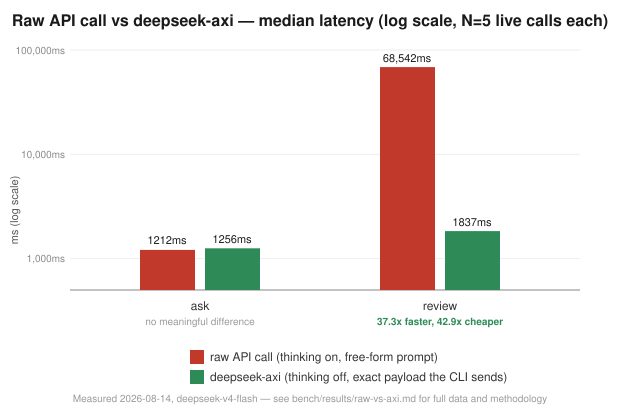

# deepseek-axi

An [AXI](https://axi.md)-pattern CLI that lets an agent (Claude Code, or anything else that can
shell out) delegate work to **DeepSeek V4** — hard reasoning, long-context (1M token) work, and
real autonomous fixes to a repo — without an MCP server, a config file, or a running process.
Same shape as `gh-axi`, `chrome-devtools-axi`, `lavish-axi`: a `{domain}-axi` binary an agent
invokes directly. Pure Rust, no runtime dependency.

## Install

### Prebuilt binary (curl)

```sh
curl -fsSL https://raw.githubusercontent.com/lambiengcode/deepseek-axi/main/install.sh | bash
```

Detects your OS/arch, downloads the matching binary from the latest GitHub Release, and installs
it to `~/.local/bin` (override with `DEEPSEEK_AXI_INSTALL_DIR`). Covers macOS (Apple Silicon +
Intel) and Linux (x86_64 + arm64) — see [`install.sh`](./install.sh). Releases are published
automatically by [`.github/workflows/release.yml`](./.github/workflows/release.yml) whenever a
`vX.Y.Z` tag is pushed; a [`ci.yml`](./.github/workflows/ci.yml) workflow runs `cargo fmt`,
`cargo clippy -D warnings`, and the full test suite on every push/PR first. `deepseek-axi update`
self-upgrades in place afterwards via the same releases (`self_update` crate,
`src/commands/update.rs`).

**No release has been tagged yet** — the pipeline above is wired up and ready, but hasn't been run
against a real tag, so the curl command has nothing to download until the first `git tag vX.Y.Z &&
git push --tags` happens. Build from source in the meantime:

### From source (dev)

```sh
git clone <this-repo> deepseek-axi && cd deepseek-axi
cargo build --release
export DEEPSEEK_API_KEY=sk-...          # https://platform.deepseek.com/api_keys
./target/release/deepseek-axi           # no-args home view: shows key/model status, next steps
ln -s "$(pwd)/target/release/deepseek-axi" ~/.local/bin/deepseek-axi   # put it on PATH
```

```sh
cargo test              # 80 tests, no network/API key needed — see Development below
cargo build --release   # optimized binary, what the numbers in Benchmarks below were measured on
```

## What it is

Two tiers:
- **Advisory** (`ask`, `think`, `review`, `inspect`) — stateless, read-only, single-shot. Answers
  questions about code, never touches git.
- **Worker** (`run`, `test --fix`) — a real understand→plan→implement→test→verify loop, editing
  files in an isolated git worktree, with two-sided verification before it ever calls something
  "verified."

If a task doesn't clearly need either — it's not hard reasoning, not long-context, and not a real
code change — just do it in the calling agent directly. This tool is an escape hatch, not a
replacement.

### Auth

```sh
export DEEPSEEK_API_KEY=sk-...
```

Get a key at [platform.deepseek.com/api_keys](https://platform.deepseek.com/api_keys). That's the
only required configuration — `deepseek-axi` with no args shows whether it's picked up:

```
$ deepseek-axi
bin: ~/.../bin/deepseek-axi
description: Delegate reasoning and long-context work to DeepSeek V4
apiKey: missing
defaultModel: deepseek-v4-flash
calls: 0
help[2]: Set DEEPSEEK_API_KEY to get started: export DEEPSEEK_API_KEY=sk-...,Get a key at https://platform.deepseek.com/api_keys
```

Other env vars, all optional: `DEEPSEEK_BASE_URL` (default `https://api.deepseek.com`),
`DEEPSEEK_AXI_CONFIG_DIR` (default `~/.config/deepseek-axi`), and `DEEPSEEK_AXI_TIMEOUT_MS` — the
per-request HTTP timeout, default **300000** (300s); raise it for slow networks or long worker-tier
generations, lower it to fail fast. See [`.env.example`](./.env.example).

### Ambient context (optional)

```sh
deepseek-axi setup hooks
```

Installs a `SessionStart` hook for all three targets `axi-sdk-js` supports — Claude Code
(`~/.claude/settings.json`), Codex (`~/.codex/hooks.json` + `hooks = true` in
`~/.codex/config.toml`), and a generated plugin for OpenCode (`~/.config/opencode/plugins/`) — so
the home view above appears automatically at session start, the same mechanism behind the
`gh-axi`/`chrome-devtools-axi`/`lavish-axi` banners you already see in this environment. Each
target is best-effort and idempotent: a missing directory is created, an already-installed hook
is left alone, and one target failing doesn't stop the others.

## Advisory tier — read-only, stateless

Everything here is a pure read against DeepSeek's API — safe to retry, never touches git.

### `ask "<prompt>" [--model flash|pro] [--files <path>]... [--json]`

One-shot query. Defaults to `deepseek-v4-flash`, thinking mode explicitly disabled (it's never
surfaced, so there's no reason to pay for it). Prints the model's answer as plain text/markdown on
stdout — free-text output is never TOON-wrapped, only structured data is.

```sh
deepseek-axi ask "Summarize the tradeoffs of optimistic locking"
deepseek-axi ask "What does this config do?" --files config.yaml
```

`--files` inlines file contents straight into the prompt (repeatable flag) instead of making the
calling agent read the file into its own context just to paste it back in.

### `think "<prompt>" [--effort low|high|max] [--full] [--files <path>]...`

Always uses `deepseek-v4-pro` with thinking mode on. The chain-of-thought is hidden by default
(size hint on stderr), `--full` shows it. `--effort` maps directly to DeepSeek's
`reasoning_effort`.

```sh
$ deepseek-axi think "Is this backfill safe under concurrent writes?" --files migration.sql
reasoning_tokens: 1842 (use --full to show reasoning_content)     # stderr
<final answer text>                                                # stdout
```

### `review <path...> [--model flash|pro] [--query <text>]`

Reads file(s), asks DeepSeek (JSON mode forced, thinking disabled) for structured findings,
renders them as a TOON table:

```sh
$ deepseek-axi review src/auth.ts src/session.ts --model pro
filesReviewed: 2
count: 1
findings[1]{file,line,severity,summary}:
  src/session.ts,42,high,Session token is compared with == instead of a constant-time check
```

### `inspect --task "<text>" [--files <path>]... [--budget N] [--max-files N] [--json]`

Read-only context discovery: git status/diff, files related to what's touched (grep-based, not
AST resolution — deliberately simple), matching tests — assembled under a token budget with the
diff prioritized over discovered files. No model call, no network. Standalone-useful, and it's
`run`'s first stage under the hood. Backed by ripgrep's own `grep`+`ignore` crates linked directly
into the binary — no subprocess, no hand-rolled walker.

```sh
$ deepseek-axi inspect --task "fix the failing auth test"
task: fix the failing auth test
branch: main
touchedFiles[1]: src/auth.ts
relatedFiles[2]: src/session.ts,test/auth.test.ts
tokensEstimate: 1840
included[3]: git-diff,related:src/session.ts,test:test/auth.test.ts
dropped: []
```

### `models` / `cache stats [--task <id>]`

`models` is a static reference table. `cache stats` surfaces DeepSeek's automatic disk-based
context caching (on by default, zero-config) instead of leaving it invisible — cumulative
hit/miss token counts and hit rate, `--task <id>` scopes it to one `run`/`test --fix` task. No
dollar estimate — DeepSeek's cache-hit pricing isn't confirmed as machine-readable text yet;
guessing would be wrong. Delete `~/.config/deepseek-axi/usage.json` to reset.

## Worker tier — a real understand→implement→test→verify loop

`run` and `test --fix` actually edit files and run your tests, inside an isolated git worktree by
default — never your real branch. Every dependency (git, the model, the filesystem) that a task
needs is offered to the model as a tool call (`read_file`, `grep`, `list_files`, `write_file`,
`fim_edit`, `run_tests`); it gathers its own context and applies its own edits rather than
everything being pre-computed for it. `fim_edit` lets the model make small, single-location fixes
via DeepSeek's Fill-In-the-Middle endpoint instead of a full chat-completion turn — it picks
whichever tool fits the edit.

### `run --task "<text>" [--files <path>]... [--model flash|pro] [--max-files N] [--max-iterations N] [--max-cost USD] [--timeout S] [--dry-run] [--no-worktree] [--skip-regression-check] [--json] [--summary]`

```sh
$ deepseek-axi run --task "add input validation to the signup form"
status: verified
summary: "..."
filesChanged[2]{path,insertions,deletions}:
  src/signup.ts,14,2
  test/signup.test.ts,9,0
verification:
  targetFixed: true
  noRegressions: true
branch: deepseek-axi/a1b2c3d4
help[1]: Review the diff and merge/PR branch deepseek-axi/a1b2c3d4 when ready
```

### `test --fix [--max-iterations N] [--test-cmd "<cmd>"] [--skip-regression-check] [--timeout S] [--no-worktree] [--json] [--summary]`

A focused version of `run`: skip planning from scratch, run your test command immediately, and
feed any failure straight to `deepseek-v4-pro` to diagnose and fix, retrying up to
`--max-iterations`.

### Safety model

- **Isolated by default.** `run`/`test --fix` create `git worktree add -b deepseek-axi/<taskId>`
  off current HEAD before any edit — your real branch and working tree are never touched.
  `--no-worktree` is an explicit opt-out.
- **Checkpointed.** Every iteration that changes files is committed inside the worktree.
- **Two-sided verification, on by default.** Before calling anything `verified`, it confirms the
  failure genuinely reproduces on the base commit *and* the worktree is green after the fix
  (SWE-bench-style) — not just "the tests I chose to run passed." `--skip-regression-check` opts
  out of the base-commit run for speed, and that corner-cut is surfaced in the result's `risks`,
  never hidden.
- **Never merges anything itself.** On success the branch is left for you to review/merge/PR.
- **Real budget stops.** `--max-iterations`/`--max-cost`/`--timeout` are enforced by the loop
  itself; hitting one preserves whatever partial work exists (promotes the branch instead of
  discarding it) rather than throwing it away.
- **`--dry-run`** plans only — the model is not even offered the `write_file`/`fim_edit`/
  `run_tests` tools in this mode, enforced at the tool-dispatch level, not just by prompting it
  not to.

### Agent-to-agent handoff format

`run`/`test --fix` return a structured result — `--json` emits it as real JSON (parses cleanly,
not TOON), `--summary` emits just the prose summary, the default is a trimmed TOON view:

```jsonc
{
  "status": "implemented" | "verified" | "partially_verified" | "failed",
  "summary": "...", "filesChanged": [...], "tests": {...},
  "verification": { "targetFixed": true, "noRegressions": true, "regressionCheckSkipped": false },
  "risks": [...], "remainingWork": [...], "nextActions": [...],
  "cost": { "iterations": 1, "model": "deepseek-v4-pro" },
  "usage": { "promptTokens": ..., "cacheHitTokens": ... },
  "branch": "deepseek-axi/a1b2c3d4"
}
```

No industry-standard schema exists for this to adopt — it's deepseek-axi's own contract.

### `update` / `update --check`

Self-update via GitHub Releases (`self_update` crate) — free once releases exist.

## Benchmarks

Real, measured numbers, not hand-wavy "it's efficient" claims.

### Efficiency vs a raw API call (the actual point of AXI)

The question that matters isn't "is the CLI fast" — it's whether wrapping DeepSeek in an
agent-ergonomic CLI beats calling the API raw, the same question
[`axi.md`](https://axi.md)'s own benchmarks (100% task success at up to 12x lower cost than MCP,
measured across 490+425 live runs) are answering for the broader AXI pattern. Here's
deepseek-axi's own live number for its two API-cost levers — thinking mode forced off when the
reasoning trace is never surfaced, and a forced JSON schema instead of free prose — measured
directly against the identical raw call, N=5 each, real DeepSeek billing:



| Task | | Duration (median) | Total tokens/call | Cost/call |
|---|---|---|---|---|
| `ask` | raw | 1212ms | 144.2 | $0.0000271 |
| `ask` | axi | 1256ms | 56.4 | $0.0000136 (**2.0x cheaper**) |
| `review` | raw | 68,542ms | 5689.8 | $0.00155795 |
| `review` | axi | 1837ms | 261.0 | $0.00003635 (**42.9x cheaper, 37.3x faster**) |

`review`'s gap is DeepSeek's thinking mode (on by default, confirmed live) spiraling on an
open-ended prompt — one raw call during this benchmark came back after 44 real seconds having
generated 3768 reasoning tokens nobody asked for, before it ever wrote its answer. Forcing thinking
off and a JSON schema on eliminates that entirely. Full methodology, why `ask`'s duration is
honestly a wash (not spun as a win), and the live confirmation call:
[`bench/results/raw-vs-axi.md`](./bench/results/raw-vs-axi.md). Raw data:
[`raw-vs-axi.json`](./bench/results/raw-vs-axi.json). Reproduce: `bash bench/raw-vs-axi.sh`.

### CLI latency (local-only commands)

| | Median (N=20) |
|---|---|
| Startup (`-v`) | 8ms |
| `models` (no network) | 8ms |
| `inspect` (file search, this repo) | 24.5ms |

Backed by ripgrep's own `grep`+`ignore` crates linked directly into the binary — no subprocess, no
hand-rolled walker. For ongoing regression tracking:

```sh
bash bench/bench.sh   # -> bench/results/rust-latency.json
```

## Design notes

Following [AXI](https://axi.md)'s agent-ergonomic principles: TOON-encoded structured output
(~40% smaller than JSON) with free text left as plain markdown; cheap model by default
(`ask`/`review` → flash, thinking explicitly disabled since it's never surfaced); reasoning
content truncated with a `--full` escape hatch; structured errors with real exit codes (`0`/`2`
`VALIDATION_ERROR`/`1` everything else); no interactive prompts anywhere; no-args shows live
state, not `--help` text; every response ends with next-step suggestions.

Crates and why:

| Crate | Role |
|---|---|
| `clap` | CLI parsing (derive API) |
| `serde`/`serde_json` | JSON |
| `ureq` | HTTP client (sync, no async runtime — smaller dependency tree than `reqwest`+`tokio` for a CLI that makes one request at a time) |
| `memchr` | SIMD-accelerated byte search — used directly in `sanitize.rs`, pulled in transitively by `grep`/`regex` for `ripgrep.rs` |
| `grep`+`ignore` | ripgrep's own library crates — real file search, not a subprocess or hand-rolled walker |
| `toon-format` | TOON output encoding |
| `self_update` | GitHub-Releases-based self-updater |

No `tokio`, no async runtime anywhere — this CLI does one thing at a time, so there was nothing
for an async runtime to buy.

Streaming (SSE against `/chat/completions`) is built and unit-tested but not wired into any
command yet — every response is currently non-streaming, which is correct for a CLI whose output
gets parsed by another agent rather than watched by a human.

### Not built (deliberately)

- Model routing (auto flash↔pro by task complexity) and parallel review lanes — both would need
  benchmark evidence before being worth the complexity, not built speculatively.
- AXI-to-AXI composition (calling `gh-axi` etc. from inside deepseek-axi) — no concrete workflow
  needs it yet.
- Dollar cost estimates anywhere — DeepSeek's cache-hit pricing isn't confirmed as machine-readable
  text; a guessed number would be worse than none.
- Per-test-framework failure parsing (Jest/pytest/go test/...) — raw failure text goes back to the
  model for diagnosis instead of a parser matrix.
- Interactive/multi-turn session mode — AXI rules out interactive prompts.

## Development

```sh
cargo build              # debug build
cargo test                # 80 tests, ~2s, no network/API key needed
cargo fmt --check         # same gate CI runs
cargo clippy --all-targets -- -D warnings   # same gate CI runs
cargo build --release    # optimized binary, what bench/ measures
```

Pure unit tests (models, sanitizer, handoff schema, hooks) with no network; `git-safety`/`verify`/
`context-engine`/`ripgrep` tests run real `git`/filesystem operations against disposable temp
directories (no mocking, since that behavior is exactly what needs proving); the worker loop's
state machine is tested with a fully stubbed model/git/verify via trait objects — deterministic,
no live API key needed. The one thing none of this covers — CI included — is real model
*quality*; that's proven by the live runs documented in [`bench/results/`](./bench/results/)
instead.

[`.github/workflows/ci.yml`](./.github/workflows/ci.yml) runs the four commands above (fmt,
clippy, build, test) on every push/PR, across Linux and macOS.
[`.github/workflows/release.yml`](./.github/workflows/release.yml) builds and publishes prebuilt
binaries for both OSes (x86_64 + arm64 each) to GitHub Releases whenever a `vX.Y.Z` tag is pushed
— see [Install](#install) above.

## References

- [axi.md](https://axi.md) — the AXI design philosophy this tool follows
- [github.com/kunchenguid/axi](https://github.com/kunchenguid/axi) — `axi-sdk-js`, the JS AXI SDK
  this build's hook-installer logic (`src/hooks.rs`) is ported from
- [api-docs.deepseek.com](https://api-docs.deepseek.com) — DeepSeek V4 API reference
- [github.com/harshj23/deepseek-claude-mcp-server](https://github.com/harshj23/deepseek-claude-mcp-server) —
  the MCP-server predecessor this tool supersedes with a CLI-first design
